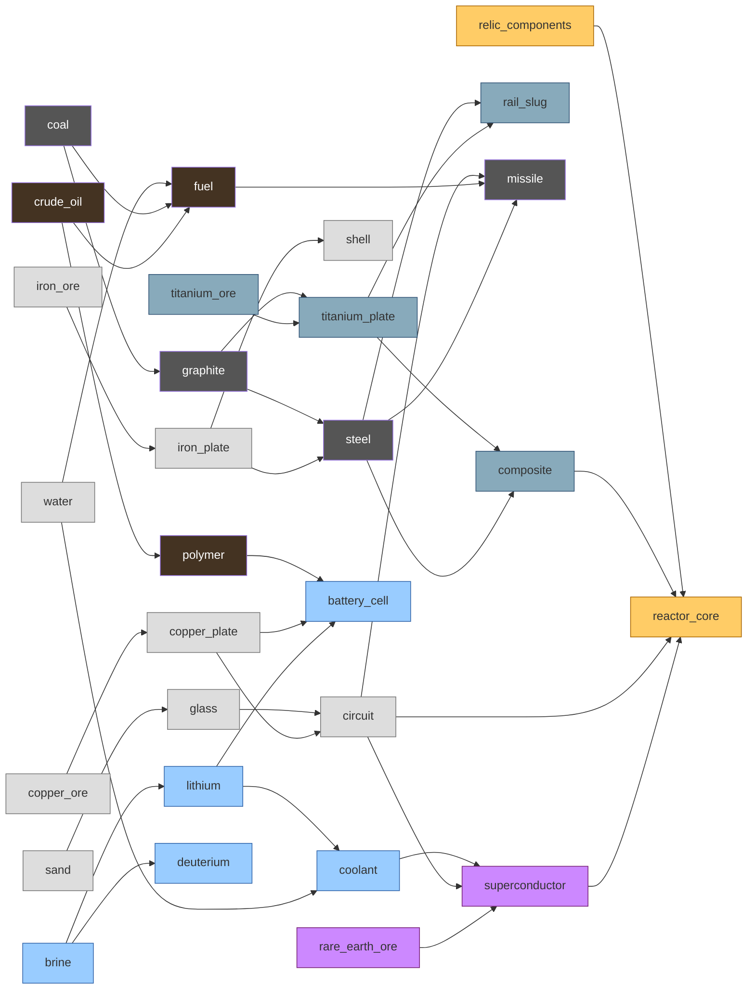

# Content & balance update: catalogue, tech tree, factions, pace

Status: **draft for discussion** (2026-10-21). Companion to `content-update.md`. This file covers four things:
- the resource catalogue by tier, solid and fluid (§1). It extends that draft's slot table (§2 there).
- the item tech tree and what each item needs (§2).
- the vanilla faction templates and their rules (§3).
- the game pace, anchored to grand strategy (§4). This replaces the pacing table in `content-update.md` §6.

**Principles:** the content design principles are in `specs/requirements/content-design.md` (CD-001..009), and
this draft is reworked against them. Until then, these parts predate them and are superseded:
- §1.2: placement per item. Placement is map design (CD-007).
- §1.3: the item count. There is no fixed content budget (CD-008).
- §2.4 rule 3: tier 3 buildings needing two regional raws (CD-007).
- §3.2: the faction reasoning in unit-level terms (CD-005).
- §2.3: the tiers' steps don't match CD-001's verbs yet. CD-001 makes tier 2 "reach" (units fly, ports link tiles,
  turrets hold ground), but ports and frames are tier 1 here and the start scout already flies.

Names follow CD-009 (names say what things are); the draft's failing names were replaced in OQ-62. The role table
under discussion is OQ-60, with chemistry options (coke, titanium from brine, cutting coolant) not applied here yet.

The constraints already decided still hold:
- **Cost-gated progression** (TT-001): the "tech tree" below is the recipe graph. Nothing unlocks. You can build an
  entry once you can pay for it, and you can pay once you hold the raw resources behind it.
- **Capture to build** (MP-010) is the only other gate, and only for factions that have the rule.
- Names are placeholders. The slot ids (R/P/C/A/X) are the agreed structure. New slots are added here, none are
  renumbered.

The numbers are a first pass, checked against the value yardstick (`content-update.md` §6.1): value = input values +
machine time + power. `tools/balance.py` will tune them.

## 1. Resource catalogue

### 1.1 Solid and fluid

| | Solid | Fluid |
|---|---|---|
| Moved by | belts, routers, sorters, bridges (as today) | **pipes**: a new cell layer (FB-022) that runs under buildings, like cables |
| Network | per belt cell, 4 items | pooled per connected pipe run, **one fluid per network**, modelled on `PowerNetwork` (supply, demand, buffer) |
| Stored in | cores, containers, vaults | cores (cap per fluid), **tanks** |
| Between tiles | port pairs | port pairs carry fluid as shipments (an export port on a pipe fills, an import port feeds one) |
| Units | 1 = one item | 1 = one *unit*. Fluids come in 10s, so a recipe reads "20 brine", not "2 brine". |
| Deposits | patches, finite (RS-004) | oil and brine are patches, finite but large. Water has no deposit: any water cell, never runs out. |

Fluids need code: the pipe layer, the network solver, tanks, fluid ports, pumps on water cells (`content-update.md` §8
item 5). That decides `content-update.md` C-4 against "fluids as items for now". The fallback, if pipes slip, is to
treat fluids as items on belts with 10x amounts. Then no recipe changes; only the logistics would be different.

### 1.2 Raw resources (tier 1)

| Slot | Placeholder | State | Where | Scarcity weight (value) | Deposit |
|---|---|---|---|---|---|
| R1 | iron ore | solid | every tile | 1 | 200 / cell |
| R2 | copper ore | solid | every tile | 1 | 200 / cell |
| R3 | sand | solid | every tile (desert, beach, plains richest) | 1 | 200 / cell |
| R4 | coal | solid | regional 35%: forest, grassland, hills. Always on a neighbour of each start. | 1.5 | 200 / cell |
| R5 | titanium ore | solid | regional 30%: mountain, hills. Always within 2 tiles of each start. | 2 | 150 / cell |
| R6 | brine | fluid | regional, 40% of tiles with shallow water. Pumped from a platform. | 0.05 / unit | 3000 / cell |
| R7 | rare-earth ore | solid | rare 10%: mountain, desert, never within 2 tiles of a start | 6 | 80 / cell |
| R8 | relic components | solid | relic hulks only, finite per world (`content-update.md` §2.1) | 8 | 20-60 per hulk |
| **R9** *new* | water | fluid | any water cell (shallow water, river) | 0.02 / unit | none, endless |
| **R10** *new* | crude oil | fluid | regional 30%: desert, plains, beach. Never on a start tile. | 0.15 / unit | 2000 / cell |

What each regional resource gates:

| Raw | Gates | Without it you can't make |
|---|---|---|
| coal (R4) | tier 2 → 3 structure | graphite, titanium plate, steel, composite, rail slugs, missiles, every tier 3 building |
| titanium (R5) | tier 2 → 3 armour | titanium plate, composite, rail slugs, armour, the Railgun |
| crude oil (R10) | power and polymers | polymer (so battery cells). Fuel can still come from coal, at 2x the cost. |
| brine (R6) | tier 3 energy | lithium, battery cells, coolant, deuterium, so superconductors and fusion |
| rare-earth ore (R7) | tier 4 | superconductor, reactor core |
| relic components (R8) | the Wunderwaffe | reactor core, so the Particle Beam, the Large Shield Generator and the Fusion Reactor |

Water and the three common ores are on every start. Everything above tier 2 needs land you have to take, except
circuits: electronics stay reachable from home (§2.2).

### 1.3 Processed items (tiers 2-4)

The item count was "about 25". It is now **29**: 26 from the draft (with R8) plus water, crude oil, polymer and coolant, less the plasma cell (OQ-62: energy weapons run on power).

| Slot | Placeholder | Tier | State | Value | Made from |
|---|---|---|---|---|---|
| P1 | iron plate | 2 | solid | 2.1 | iron ore |
| P2 | copper plate | 2 | solid | 2.1 | copper ore |
| P3 | glass | 2 | solid | 2.1 | sand |
| P4 | graphite | 2 | solid | 3.1 | coal |
| P5 | titanium plate | 2 | solid | 7.3 | titanium ore + graphite |
| P6 | lithium | 2 | solid | 2.2 | brine |
| P7 | deuterium | 2 | **fluid** | 0.43 / unit | brine |
| P8 | fuel | 2 | **fluid** | 0.16 / unit | crude oil (refinery), or coal + water (liquefier) |
| **P9** *new* | polymer | 2 | solid | 1.6 | crude oil (refinery byproduct) |
| A1 | shell | 2 | solid | 0.43 | iron plate |
| C1 | steel | 3 | solid | 7.6 | iron plate + graphite |
| C2 | circuit | 3 | solid | 4.3 | copper plate + glass |
| C3 | composite | 3 | solid | 15.2 | steel + titanium plate |
| C4 | battery cell | 3 | solid | 8.3 | lithium + copper plate + polymer |
| **C5** *new* | coolant | 3 | **fluid** | 0.14 / unit | water + lithium |
| A2 | rail slug | 3 | solid | 3.8 | titanium plate + steel |
| A3 | missile | 3 | solid | 6.8 | steel + fuel + circuit |
| X1 | superconductor | 4 | solid | 31.5 | rare-earth ore + circuit + coolant |
| X2 | reactor core | 4 | solid | 59.9 | superconductor + circuit + composite + relic components |

These values apply the fixes `content-update.md` §2 held back: composite at 1 + 1, and the liquid fuel is now a fluid,
so it isn't another "cell". Tier bands come out at about 2-7 (tier 2), 4-15 (tier 3) and 16-60 (tier 4). Ammo sits low
on purpose, because it's consumed in bulk.

### 1.4 Recipes

These replace the recipe table in `content-update.md` §2 (ticks at 60 per second).

| Building | Recipe | Inputs → outputs | Ticks |
|---|---|---|---|
| Drill | mine iron, copper, sand, coal | → 1 | 60 |
| Heavy Drill | mine iron, copper, sand, coal | → 1 | 30 |
| Heavy Drill | mine titanium | → 1 titanium ore | 60 |
| Offshore Pump *new* | pump water | → 20 water | 60 |
| Oil Well *new* | pump crude | → 10 crude oil | 60 |
| Brine Pump | pump brine | → 20 brine | 60 |
| Rare-earth Bore | mine rare-earth ore | → 1 rare-earth ore | 180 |
| Smelter | iron plate, copper plate, glass | 2 ore or sand → 1 | 120 |
| Coking Oven | graphite | 2 coal → 1 | 120 |
| Arc Furnace | titanium plate | 2 titanium ore + 1 graphite → 1 | 180 |
| Arc Furnace | fast iron plate, fast copper plate | 2 ore → 1 | 60 |
| Refinery *new* | crack crude | 20 crude oil → 10 fuel + 1 polymer | 240 |
| Liquefier *new* (was the Fuel Press) | coal fuel | 2 coal + 10 water → 10 fuel | 120 |
| Electrolyser | lithium | 40 brine → 1 lithium | 180 |
| Electrolyser | deuterium | 80 brine → 10 deuterium | 300 |
| Chemical Plant *new* | coolant | 20 water + 1 lithium → 20 coolant | 180 |
| Steel Mill | steel | 2 iron plate + 1 graphite → 1 | 240 |
| Assembler | circuit | 1 copper plate + 1 glass → 1 | 120 |
| Assembler | battery cell | 2 lithium + 1 copper plate + 1 polymer → 1 | 240 |
| Alloy Forge | composite | 1 steel + 1 titanium plate → 1 | 300 |
| Munitions Works | shells | 1 iron plate → 5 | 60 |
| Munitions Works | rail slugs | 1 titanium plate + 1 steel → 4 | 180 |
| Munitions Works | missiles | 1 steel + 10 fuel + 1 circuit → 2 | 240 |
| Superconductor Works | superconductor | 4 rare-earth ore + 1 circuit + 20 coolant → 1 | 360 |
| Precision Works | reactor core | 1 superconductor + 1 circuit + 1 composite + 1 relic components → 1 | 600 |
| Fuel Generator | burn fuel | 10 fuel | 240 |
| Fusion Reactor | burn deuterium | 10 deuterium + 20 coolant | 1200 |

The copper ore → fuel fallback is dropped: at the start, cores give power, and the first fuel needs coal (a neighbour)
or oil. See question K-3.

### 1.5 New fluid buildings

These are on top of the ≈66 buildings in `content-update.md` §3, which makes about 72.

| Building | Size | Tier | Power | Cost (indicative) | Notes |
|---|---|---|---|---|---|
| Pipe | 1x1 layer | 2 | | 1 iron plate | the `pipe` layer: under buildings, joins touching machines' fluid inputs and outputs |
| Offshore Pump | 2x2 | 2 | 2 | 10 iron plate, 5 copper plate | on a platform over any water |
| Oil Well | 2x2 | 2 | 6 | 20 iron plate, 10 copper plate | on a crude oil patch |
| Tank | 3x3 | 2 | | 30 iron plate | holds 5000 of one fluid |
| Refinery | 3x3 | 2 | 20 | 40 iron plate, 20 copper plate, 10 glass | |
| Liquefier | 2x2 | 2 | 2 | 15 iron plate, 10 copper plate | renamed Fuel Press; tier 2, as its water needs a tier 2 pump |
| Chemical Plant | 3x3 | 3 | 10 | 20 steel, 10 titanium plate, 10 glass | |

## 2. Tech tree (resource-gated)

### 2.1 The graph

Each item points to the items made from it. The colours show which **regional** raw resource first enters the chain.

### 2.2 Raw prerequisites per item

The tree is complete when each item's raw closure holds. Validation already computes this per faction
(`FactionDef.Producible`), and it doubles as the codex's "needs" line.

| Item | Tier | Regional raws needed | Notes |
|---|---|---|---|
| iron/copper plate, glass, shell | 2 | none | the start economy |
| graphite | 2 | coal | |
| fuel | 2 | coal **or** crude oil | two routes, the only "or" in the tree |
| polymer | 2 | crude oil | |
| titanium plate | 2 | coal, titanium | |
| lithium, deuterium | 2 | brine | |
| circuit | 3 | none | electronics stay reachable from home |
| steel | 3 | coal | |
| missile | 3 | coal (+ oil or more coal for fuel) | |
| composite, rail slug | 3 | coal, titanium | |
| coolant | 3 | brine | |
| battery cell | 3 | brine, crude oil | |
| superconductor | 4 | rare-earth ore, brine | |
| reactor core | 4 | rare-earth ore, relic, coal, titanium, brine | everything except oil: the Wunderwaffe needs a spread empire |

### 2.3 What each tier opens (buildings by the items in their cost)

A building's tier is the highest tier in its cost (`content-update.md` §3). This is the "tree" a player climbs:

| Tier | You hold | You can now build | The step that matters |
|---|---|---|---|
| 1 | the start | drill, smelter, coking oven, conveyor, ports, core, platform, frame, cable | a working smelting line |
| 2 | plates, glass | gun turret, autocannon, wall, munitions works, assembler, liquefier, offshore pump, oil well, pipe, tank, refinery, brine pump, fast conveyor, container, boosters, scout parts | **fluids**: first pipe network, first fuel power |
| 2+ | + graphite, titanium plate | titanium wall, armour plate, electrolyser | first expansion pays off |
| 3 | steel, circuits | heavy drill, arc furnace, alloy forge, unit factory, laser turret, missile battery, railgun, shield, chemical plant, solar, substation, ion thruster, tracks | **armies**: the factory, and the offence crossover (NR-006) |
| 3+ | + composite, battery cells, coolant | composite wall, heavy armour, capacitor bank, vault, maglev, long bridge, rare-earth bore, superconductor works, bastion core | the deep chain across 3-4 tiles |
| 4 | superconductor | precision works | |
| 4+ | + reactor core | particle beam, large shield generator, fusion reactor, the reactor-core booster (Flux Accelerator, to be renamed under CD-009) → Leviathan | **the Wunderwaffe** |

### 2.4 Validation rules to add

1. Every item is producible from the full catalogue (no orphan items).
2. Every tier above 1 has a regional raw in its closure (RS-003, as worded).
3. Every building whose cost is tier 3 or higher needs at least two regional raws. This rule is what makes expansion
   the gate.
4. The reactor core needs rare-earth ore and relic components (WW-003).
5. Fluids: a fluid in a building's **cost** is paid through fluid infrastructure (a pipe or tank feeding the core,
   CD-006), and every fluid has a maker
   building with a pipe connection.

## 3. Vanilla faction templates

### 3.1 Rules

The rule types today are `capture_to_build` and `buff` (stat `speed`, `power`, `build_speed`). These basic stats are
added to `buff`, one percentage each, all in the same fixed list (MP-010):

| Stat | Changes | Notes |
|---|---|---|
| `cost` | building and block costs, rounded up per item | applied in `Funds.CanPay`/`TryPay`, so preview and AI see it |
| `hp` | building and block HP | |
| `upkeep` | unit upkeep (UD-013) | |
| `claim_time` | the circle capture timer (WM-006) | for every circle the seat claims |
| `salvage` | yield from wrecks and relic hulks | |
| `extraction` | items made per unit drawn from a patch | deposits last longer, the RS-004 lever |

Each rule covers buildings, a kind, or (new) `"tier": n` for every building of that tier, so content doesn't have to
list ids.

### 3.2 Templates

Five playable factions plus the Keepers. Each one has a pace shape (§4): a part of the match where it's strongest.

| Faction | Fantasy | Peak | Subset | Rules | Start |
|---|---|---|---|---|---|
| **Charter Company** (default) | the baseline Corps | even | everything | none | scout |
| **Foundry Guild** | heavy industry | middle (tier 3) | no Rotor, no Ion Thruster (no helicopters or fast air) | `speed` +20 machines; `upkeep` +25; variant Wall → Bulwark | scout |
| **Nomad Clans** | raiders and salvagers | early and the ruins | no Laser Turret, Shield Generator, Large Shield Generator | `capture_to_build`: Unit Factory, Large Core, Precision Jig, Precision Works; `salvage` +100; `upkeep` -30; `claim_time` -33 | caravan (scout + cargo pod) |
| **Tidewater Combine** | fluids and the sea | middle to late (tier 3 energy) | no Tracks, no Railgun | `speed` +30 on pumps, refinery, electrolyser, chemical plant; `extraction` +25 on fluids; variant Hull → Pontoon Hull (more HP and cargo) | scout |
| **Concord Restorationists** | relic scholars, tall play | late (tier 4) | no Autocannon, no Missile Battery | `cost` -20 on tier 4; `salvage` +50; `speed` -15 on smelter and coking oven | scout + depot |
| Keepers *(hidden)* | neutral guardians (WM-010) | | neutral buildings | as today | sites |

Checked against the MP-009 gate: no denied building is the only maker of an item. Nomads still make every item
(the Precision Works is captured, not denied). Every denied building is a combat or locomotion end node.

Why each one doesn't break NR-006 or WW-005:
- **Foundry Guild:** turtles well on cheap industry, but has no air. Lancers counter its Leviathan, so it needs
  allies' or its own Railgun lines.
- **Nomad Clans:** strong early raids and cheap armies, but no shields. A Leviathan needs a captured Precision Works,
  so Keeper sites are their road to tier 4.
- **Tidewater Combine:** wins the energy race, but has no heavy ground. Its land war is air and missiles.
- **Concord Restorationists:** slow early (the smelter malus), weak early defence without autocannons, the cheapest
  Wunderwaffe. The classic "survive to the late game" pick.

`content-update.md` §1.5 said every seat is mechanically the same. MP-009 since made factions part of the game. Corps
names stay cosmetic per seat; a faction is the kit under the name (K-1).

## 4. Pace: anchored to grand strategy

### 4.1 What we borrow

Grand strategy games (Europa Universalis, Hearts of Iron, Stellaris, Crusader Kings) share a pacing structure. These
are rough figures from common play, not measurements: single-player campaigns run tens of hours, and multiplayer
sessions run 3-5 hours, played over several evenings from saves. This structure fits this game:

| Grand strategy device | Here | Already have it? |
|---|---|---|
| A **calendar** that pulses monthly (income, upkeep) | **1 real minute at 1x = 1 in-world month.** Upkeep is already paid each minute (UD-013): it becomes "monthly upkeep". A year is 12 minutes. The date shows in the HUD on the Concord calendar (L-5). | upkeep yes, date no |
| **Eras** with a different main pressure each | the tiers (§4.2) | tiers yes |
| **Speed controls and pause** | single player: pause, 1x, 2x, 4x (the tick loop already runs up to 8 ticks a frame). Online: host picks 1x or 2x, no pause (OQ-32). | partly |
| **Long sessions over several evenings** | replay saves + snapshots (NF-008) load long matches fast; rate mode (FB-012) keeps the unviewed tiles cheap | yes |
| **An end date and a score** | the **charter term**: a match has an end date; when it runs out, the highest score wins (tiles held, plus output). It fits the lore: a reclamation charter is a contract with a term. Domination (MP-001) still ends a match early. | no |
| **Brakes on snowballing** (coalitions, war exhaustion, admin cost) | upkeep, depletion (RS-004), Keeper sites stronger farther out (WM-018), Contested tiles (WM-004). Maybe an overhead per tile past a cap (K-5). | mostly |
| **An endgame crisis** | candidate: dormant war machines in relic hulks wake at 80% of the term (K-6) | no |

### 4.2 Eras

These are shares of the charter term, so they scale with the preset (§4.3).

| Era | Share of term | Tier | Main pressure | Grand strategy analogue |
|---|---|---|---|---|
| Landfall | 0-10% | 1-2 | build the first line and pipes, find coal and oil | the opening, picking a direction |
| Expansion | 10-30% | 2-3 | claim circles, first sites, first regional chains | colonisation, the land grab |
| Consolidation | 30-55% | 3 | factories, multi-tile chains, depletion forces moves | development, building tall or wide |
| Conflict | 55-80% | 3-4 | the NR-006 crossover: armies beat defences, relic hulks and rare-earth ore contested | the great wars |
| Endgame | 80-100% | 4 | Wunderwaffe, reactor cores, the term runs out | the crisis, the late game |

### 4.3 Pace presets

One match setting, **Pace**, picks the term and the knobs that stretch the curve. **Machine and belt speeds never
change**, so a factory feels the same at every pace. What stretches is how much land, how much raw and how much tier 3-4
cost stands between the eras.

| Preset | Term (real time at 1x) | In-world | Tiles per player | Richness | Tier 3 / 4 cost | Claim time | Site strength |
|---|---|---|---|---|---|---|---|
| Mission (campaign) | 15-45 min | set by the mission | 1-12 total | set | 100% | 30 s | set |
| Skirmish | 90 min | 7½ years | 5 | 100% | 100% / 100% | 30 s | 100% |
| Long | 3 h | 15 years | 8 | 75% | 150% / 200% | 45 s | 150% |
| **Grand** | 8 h (2-3 sessions) | 40 years | 15 | 50% | 200% / 400% | 60 s | 250% |

Tiles per player and richness are existing settings (map size, `RichnessPercent`). Claim time is `CaptureSeconds`.
The tier cost factor and site strength are new: one `GameSetup.PacePercent` that content scales by tier. Lower
richness makes depletion the long-game engine, the way grand strategy uses resource pressure: home patches run out
in the Consolidation era and force moves outward.

### 4.4 Milestones

The Skirmish column is `content-update.md` §6's table, with in-world dates added. Grand is the same eras, stretched.

| Milestone | Skirmish (min) | Skirmish date | Grand (h) | Grand date |
|---|---|---|---|---|
| tier 2 running, first pipes | 2-4 | Feb-Apr 3037 | 0.3 | 3038 |
| first expansion claimed | 6-9 | Jul-Oct 3037 | 0.6-1 | 3039-40 |
| tier 3 (steel + circuits) | 12-18 | 3038 | 1.5-2 | 3043-45 |
| first factory-built unit | 15-20 | 3038 | 2 | 3045 |
| conflict era (armies beat defences) | 50 | 3041 | 4.5 | 3059 |
| tier 4 (superconductor) | 30-40 | 3039-40 | 4.5-5.5 | 3059-63 |
| first Wunderwaffe | 50-70 | 3041-42 | 6-7 | 3067-72 |
| match end (term or domination) | 60-90 | 3042-44 | 6-8 | 3067-77 |

On Skirmish, tier 4 (30-40 min) opens before the Conflict era (about 50 min). That is intended: the Leviathan is
built in the Conflict era, not opened by it.

### 4.5 How to check it

- `tools/balance.py` reports, per preset, the minutes from tier to tier for one well-run start (machine counts ×
  chain times × the costs of the buildings).
- `AiTests` plays a 2-AI match per preset at headless speed (the Grand preset with `Category=Long`), records each
  milestone's tick, and checks it against §4.4 within ±25%.

## 5. Code work this adds

On top of `content-update.md` §8:

1. **Fluids**: an `ItemDef.Fluid` flag; a `pipe` layer kind; a pipe network solver per tile, joined across port pairs
   like `PowerWorld`; tanks; fluid ports; pumps on water cells (no deposit) and on fluid patches; rate mode flows; hashing
   and snapshots. This is the biggest item. It becomes FB-024 in `factory-logistics.md`.
2. **Recipes with two outputs**: check the refinery (fuel + polymer) works in machines, rate mode and the AI planner.
3. **Buff stats** `cost`, `hp`, `upkeep`, `claim_time`, `salvage` and `extraction`, plus `tier` coverage, in
   `FactionRule` (MP-010).
4. **Calendar**: a date from `Tick` (a pure function, nothing to hash); the HUD clock shows it.
5. **Charter term**: `GameSetup.TermMinutes` + score, checked in `Victory` (MP-001 gets an end-date condition).
6. **Pace**: `GameSetup.PacePercent` (tier cost factor, site strength) and the match setting; presets in the lobby.
7. **Speed control**: single-player pause/1x/2x/4x; an online host speed of 1x/2x through lockstep.
8. **Validation**: the §2.4 rules in `ContentDb.Validate`.

## 6. Open questions

| # | Question | Leaning |
|---|---|---|
| K-1 | Factions have different kit (MP-009), while `content-update.md` §1.5 has every Corps the same. Is a faction a Corps "type" (Charter Company, Nomad Clans) with cosmetic names on top? | yes: faction = kit, Corps name = cosmetic |
| K-2 | Pipes as a real network (§1.1), or fluids as items on belts with 10x amounts? | pipes; the belt fallback only if the network slips |
| K-3 | Drop the copper ore → fuel fallback, so starts without a coal or oil neighbour have only core power until they expand? | drop it; every start has a coal neighbour |
| K-4 | 1 minute = 1 month at 1x? | yes; upkeep already runs monthly |
| K-5 | An overhead per tile beyond a cap (grand strategy "admin capacity") to slow the leader? | not yet: watch whether upkeep and depletion are enough on Grand |
| K-6 | An endgame crisis (dormant war machines wake at 80% of the term)? | later, after the campaign |
| K-7 | Is the term's score tiles held + output, or tiles only? | tiles + total value produced, so builders can win on the term |
| K-8 | Pace presets in multiplayer: the host picks? | yes, with the other match settings (MP-005) |
| K-9 | Should Grand matches run 2x by default online, so a 40-year term fits 4 hours? | offer it, don't default it |
